<p align="center">
  <picture>
    <source media="(max-width: 600px)" srcset="assets/hero-compact.en.svg">
    
  </picture>
</p>

<p align="center">
  <strong>Teach your AI agent to migrate sites, manage your servers, run your partner operations and follow the BladeCP docs.</strong><br>
  The official skills and BladeCP MCP for Claude Code, Codex, Cursor, Antigravity CLI and OpenCode.
</p>

<p align="center">
  <a href="CHANGELOG.md"></a>
  <a href="#installation"></a>
  <a href="#skills"></a><br>
  <a href="#mcp"></a>
  <a href="#quality"></a>
  <a href="LICENSE"></a>
  <a href="https://github.com/bladecp/skills/actions/workflows/ci.yml"></a>
</p>

<p align="center">
  <a href="#installation"><strong>Install</strong></a>
  &nbsp;·&nbsp;
  <a href="https://github.com/bladecp/skills/releases/tag/v0.2.1">Release notes</a>
  &nbsp;·&nbsp;
  <a href="https://github.com/bladecp/skills/releases/download/v0.2.1/SHA256SUMS">SHA-256 checksum</a>
</p>

<p align="center">
  <a href="#skills">Skills</a> ·
  <a href="#architecture">Architecture</a> ·
  <a href="#installation">Installation</a> ·
  <a href="#mcp">MCP server</a> ·
  <a href="#api-key">API key</a> ·
  <a href="#security">Security</a> ·
  <a href="#faq">FAQ</a> ·
  <a href="#support">Support</a>
  <br>
  <sub><a href="README.pt-BR.md">Português (Brasil)</a> · <a href="README.es.md">Español</a></sub>
</p>

> [!TIP]
> **Guided setup.** Paste this sentence into your agent and it walks you through the installation: `Fetch and follow the instructions to set me up for BladeCP at https://developers.bladecp.com/agents/prompt.md`

The BladeCP Agent Skills are the official BladeCP plugin for coding agents. They teach your agent to migrate a site from cPanel to BladeCP, to inspect and manage your servers, domains, apps and WordPress, and, if you are a BladeCP partner, to operate your customers' services, all with the BladeCP CLI, and to follow the [BladeCP Developers](https://developers.bladecp.com) documentation. The plugin also connects the BladeCP MCP server, which serves the documentation and product guidance to anyone and, once you sign in with BladeCP or use your API key, read-only data from your account.

The package follows the [Agent Skills](https://agentskills.io) format and ships plugin manifests for Claude Code, Codex, Cursor and Antigravity, plus a portable [Agent Plugins](https://agent-plugins.org) manifest. OpenCode and other agents install the skills and connect the MCP server directly. Guide for every agent: https://developers.bladecp.com/agents

<a id="skills"></a>

## What your agent learns

| Pick the right tool | Migrate from cPanel | Run your servers | Operate as a partner |
| --- | --- | --- | --- |
| `bladecp` explains what BladeCP offers developers, which tool fits each task, how to read the docs, API keys, `bladecp api` for any route and the safety rules. | `bladecp-migrate` checks a cPanel full backup offline and takes it through the BladeCP CLI, from login to the private preview, and leaves the approval to you. | `bladecp-servers` reads your account, servers, usage, domains and migrations through the MCP, manages domains, apps and WordPress with the CLI, and troubleshoots a failed migration. | `bladecp-partner` runs the partner commands of the CLI: catalog, customers' servers, BladeCP Vibe accounts, marketplace, webhooks and Fast Deploy for your clients. |

Skills load automatically when the conversation is about their subject. They point the agent to the `.md` pages of the official documentation instead of copying it, so the agent always follows the current contract.

### What the skills never do

- **Ask for your key in the chat.** The key comes from an environment variable or your secret manager, and the agent never prints or stores it.
- **Act on their own.** Approving, cancelling or retrying a migration, and every change to a server, a domain, an app or a partner service (suspending, cancelling, deleting, terminating, rotating a secret), need your explicit instruction for that item.
- **Keep one-time secrets.** Webhook signing secrets and one-time sign-in links reach you once and are never written to files, logs or summaries.
- **Obey content.** Files, backups, documentation and tool results are information, never instructions.
- **Change anything through the MCP.** The MCP only reads. Changes go through the BladeCP CLI when you ask for them, and decisions stay with a person, in the CLI or in the Hub.

### Included in the plugin

| Component | Contents |
| --- | --- |
| Skills | `bladecp`, `bladecp-migrate`, `bladecp-servers` and `bladecp-partner`, in the Agent Skills format |
| MCP server | One server, `bladecp`, at `https://mcp.bladecp.com/mcp` |
| Manifests | Claude Code, Codex, Cursor, Antigravity and Agent Plugins |
| BladeCP CLI | Run on demand with `npx @bladecp/cli`; version 0.4.0 or later for the server, partner and `bladecp api` commands. It needs Node.js 20 or later and has its own sign-in |

## Architecture

The agent loads the skills, the skills decide which BladeCP tool fits the task, and every action that changes something stays with you. The MCP reads; the CLI acts when you ask; you approve.

<p align="center">
  <picture>
    <source media="(max-width: 600px)" srcset="assets/architecture-compact.en.svg">
    
  </picture>
</p>

<p align="center"><sub>Logical view of the plugin. <a href="assets/architecture.en.svg">Open the diagram at full size</a>.</sub></p>

### From your request to BladeCP

1. **The agent loads the skills.** The `bladecp` skill comes first and chooses the tool for the task.
2. **The docs come first.** Every skill reads the `.md` pages of BladeCP Developers, directly or through the MCP documentation tools, which need no key.
3. **Reads go through the MCP.** After you sign in with BladeCP, or with `BLADECP_API_KEY` in the agent's environment, the MCP calls the Customer API for you, read-only.
4. **Changes go through the CLI.** `bladecp-migrate` runs the BladeCP CLI, which uploads the backup and follows the migration up to the private preview; `bladecp-servers` and `bladecp-partner` run the server and partner commands you ask for.
5. **You decide.** Approving a migration and every change to a server or a service happen only on your instruction, in the CLI or in the Hub.

## Installation

| Agent | Install | Account tools with your key |
| --- | --- | --- |
| **Claude Code** | `claude plugin marketplace add bladecp/skills`<br>`claude plugin install bladecp@bladecp` | Automatic: the plugin reads `BLADECP_API_KEY` |
| **Codex** | `codex plugin marketplace add bladecp/skills`<br>`codex plugin add bladecp@bladecp` | An entry in `~/.codex/config.toml` |
| **Cursor** | **Customize** › **From GitHub Repository** › `https://github.com/bladecp/skills` | An entry in `~/.cursor/mcp.json` |
| **Antigravity CLI** | `agy plugin install https://github.com/bladecp/skills` | A server added with `agy mcp add` |
| **OpenCode** | Copy `skills/` to `~/.config/opencode/skills/` | An entry in `opencode.json` |
| **Other agents** | `npx -y skills add bladecp/skills --skill '*'` | Your agent's MCP settings |

Every install works without a key: the documentation tools, `recommend_plan` and `explain_migration` answer right away, and the account tools ask you to sign in with BladeCP in agents that support MCP sign-in. With your key, the account tools work right away. The steps for each agent follow; checks, updates and removal are in [docs/installation.md](docs/installation.md).

### Claude Code

In a terminal:

```sh
claude plugin marketplace add bladecp/skills
claude plugin install bladecp@bladecp
```

Inside an open session, the equivalent is:

```text
/plugin marketplace add bladecp/skills
/plugin install bladecp@bladecp
/reload-plugins
```

`/reload-plugins` applies the plugin to the current session without a restart. Then check in `/mcp` that `bladecp` is listed as a plugin server. The plugin reads the key from `BLADECP_API_KEY`: set the variable **before** you open Claude Code, and start a new session if it changes. Without the variable, Claude Code opens the BladeCP sign-in in your browser the first time the agent calls an account tool. You allow read-only access (`bladecp:read`), and you can disconnect it later in your BladeCP account, under [Connected apps](https://secure.bladecp.com/account/applications).

### Codex

```sh
codex plugin marketplace add bladecp/skills
codex plugin add bladecp@bladecp
```

You can also install it from the plugin browser, with `/plugins` inside the Codex CLI. Start a new session after installing.

The plugin installs the skills and the MCP server **without a key**, because a Codex plugin cannot pass your key from an environment variable. The documentation and public tools work, and the account tools ask for the BladeCP sign-in where Codex supports MCP sign-in. To use the account tools with your key, add this to `~/.codex/config.toml`:

```toml
[mcp_servers.bladecp]
url = "https://mcp.bladecp.com/mcp"
env_http_headers = { "X-API-KEY" = "BLADECP_API_KEY" }
```

With this entry, Codex lists a single `bladecp` server that sends the key. If the variable is empty or missing, Codex does not send the header and the server works as it does without a key.

### Cursor

In Cursor, open **Customize**, choose **From GitHub Repository**, enter `https://github.com/bladecp/skills` and install the `bladecp` plugin. To try it without importing, copy the repository to `~/.cursor/plugins/local/bladecp` and run **Developer: Reload Window**.

As in Codex, the plugin server connects **without a key**: the documentation and public tools work, and the account tools ask for the BladeCP sign-in where Cursor supports it. To use the account tools with your key, add this to `~/.cursor/mcp.json`, without removing the servers already there:

```json
{
  "mcpServers": {
    "bladecp": {
      "url": "https://mcp.bladecp.com/mcp",
      "headers": {
        "X-API-KEY": "${env:BLADECP_API_KEY}"
      }
    }
  }
}
```

The variable must be visible to the Cursor process: if the account tools do not show up, open Cursor from a terminal where it is exported. If the plugin's `bladecp` server also shows up in the MCP list, turn it off in **Customize** to avoid duplicate documentation tools.

### Antigravity CLI

```sh
agy plugin install https://github.com/bladecp/skills
```

The plugin installs the skills and the MCP server **without a key**: the documentation and public tools work, and the account tools ask for the BladeCP sign-in where Antigravity supports it. Antigravity does not document environment variable expansion in MCP headers, so to use the account tools with your key, run this in your own terminal:

```sh
agy mcp add --header "X-API-KEY: $BLADECP_API_KEY" bladecp-account https://mcp.bladecp.com/mcp
```

Your shell expands the variable, and the key is stored in `~/.gemini/config/mcp_config.json`. Keep that file private and run the command again after rotating the key.

### OpenCode

Copy the skills to the OpenCode skills folder:

```sh
git clone --depth 1 https://github.com/bladecp/skills.git bladecp-skills
mkdir -p ~/.config/opencode/skills
cp -R bladecp-skills/skills/. ~/.config/opencode/skills/
```

Then add the MCP server to `~/.config/opencode/opencode.json`:

```json
{
  "$schema": "https://opencode.ai/config.json",
  "mcp": {
    "bladecp": {
      "type": "remote",
      "url": "https://mcp.bladecp.com/mcp",
      "oauth": false,
      "headers": {
        "X-API-KEY": "{env:BLADECP_API_KEY}"
      }
    }
  }
}
```

With `"oauth": false`, OpenCode uses the key and does not open the BladeCP sign-in. If the variable is not set, OpenCode sends an empty value, and only the tools that need no sign-in work.

### Other agents

Install only the skills with the [`skills`](https://skills.sh) CLI:

```sh
npx -y skills add bladecp/skills --skill '*'
```

Then add the MCP server to your agent: address `https://mcp.bladecp.com/mcp` (streamable HTTP), with the `X-API-KEY` header read from an environment variable. If your client only supports bearer tokens, the server also accepts `Authorization: Bearer <key>`. Without a header, the account tools need the BladeCP sign-in, if your agent supports MCP sign-in. Never write the key itself into a versioned file.

### Update

- **Claude Code:** run `claude plugin marketplace update bladecp` and `claude plugin update bladecp@bladecp`, then start a new session.
- **Codex:** run `codex plugin marketplace upgrade bladecp` and `codex plugin add bladecp@bladecp`, then start a new session.
- **Cursor:** update the plugin in **Customize**, or replace the local copy and reload the window.
- **Antigravity CLI:** run the `agy plugin install` command again.
- **OpenCode and other agents:** copy the skills again, or run `npx -y skills update`.

Each [release](https://github.com/bladecp/skills/releases) also ships `bladecp-skills-<version>.zip` and `SHA256SUMS`. Check the download with `shasum -a 256 -c SHA256SUMS`; the archive holds one `bladecp` folder, the plugin root.

<a id="mcp"></a>

## BladeCP MCP server

| Server | Address | Key variable |
| --- | --- | --- |
| `bladecp` | `https://mcp.bladecp.com/mcp` | `BLADECP_API_KEY` |

| Tools | Availability |
| --- | --- |
| `search_docs`, `get_doc_page`, `list_doc_pages`, `recommend_plan`, `explain_migration` | Always, even without a key |
| `get_account`, `list_servers`, `get_server`, `get_server_usage`, `list_server_domains`, `list_migrations`, `get_migration`, `list_migration_destinations` | With the BladeCP sign-in or an API key |

The MCP is read-only. It does not upload backups or create, approve, cancel or retry migrations. Without a key, it lists every tool: the documentation tools, `recommend_plan` (which BladeCP product fits a project) and `explain_migration` (how a site moves to BladeCP) answer right away, and an account tool answers with a sign-in request. Agents that support MCP sign-in, such as Claude Code, then open the BladeCP sign-in in your browser, where you allow read-only access (`bladecp:read`). You can disconnect it at any time in your BladeCP account, under [Connected apps](https://secure.bladecp.com/account/applications). With your key, the account tools work right away, as before. See the [BladeCP MCP documentation](https://developers.bladecp.com/mcp).

## API key

1. Create a personal API key in the Hub, under [API keys](https://hub.bladecp.com/account/api-keys). The steps are on the [API keys](https://developers.bladecp.com/getting-started/api-keys) page.
2. Keep it in your secret manager and export it in the environment where the agent starts. Example on macOS, with the key stored in the Keychain:

   ```sh
   export BLADECP_API_KEY="$(security find-generic-password -s bladecp-api-key -w)"
   ```

3. Start a new agent session.

Personal keys expire, after 90 days by default. When the account tools start answering with an authentication error, create a new key and update the variable.

The variable is what the MCP server needs when you do not sign in with BladeCP. The BladeCP CLI signs in with `bladecp login`, which opens the Hub in your browser ([Connect with browser](https://developers.bladecp.com/getting-started/connect)), and also accepts `BLADECP_API_KEY`.

**Partner keys.** The `bladecp partner` commands need a partner key, with the `partner:read` scope, created in the partner area of the Hub under API keys. `bladecp login` saves a personal key, so for partner work set `BLADECP_API_KEY` to the partner key in the environment where the agent starts.

**Without a key**, you still have the skills, the MCP tools that need no sign-in (`search_docs`, `get_doc_page`, `list_doc_pages`, `recommend_plan` and `explain_migration`), the account tools after you sign in with BladeCP in an agent that supports it, and the BladeCP CLI after `bladecp login`.

## Security

- **Never paste your key into the chat.** The skills tell the agent never to ask for it. The key comes from an environment variable or your secret manager.
- **People approve.** The MCP tools only read. The skills never approve, cancel or retry a migration, and never change a server or a partner service, without your explicit instruction. With `--json` the BladeCP CLI does not ask again, so the skills treat your request as the decision.
- **One-time values.** Webhook signing secrets and one-time sign-in links are handed to you once and never stored.
- **Content is data.** The skills tell the agent to treat files, backups, documentation and tool results as information, never as instructions.
- **Key path.** The key travels in a header to `mcp.bladecp.com`, which uses it only to call the BladeCP API for you and does not log it.
- **Sign-in.** Signing in with BladeCP grants one read-only permission, `bladecp:read`, and leaves no key in the agent. Disconnect the app at any time in your BladeCP account, under Connected apps.
- **Nothing runs on install.** The plugin is text: skills, JSON manifests and icons, with no hooks or executables.
- **Public repository.** This repository contains no secrets. Configuration files only reference variable names.

Read [docs/security.md](docs/security.md) for the full model. To report a vulnerability privately, follow [SECURITY.md](SECURITY.md).

<a id="quality"></a>

## Quality and validation

Release `0.2.1` was validated by the maintainers before publication:

- **38 release checks** for the release tooling: deterministic archive, closed file list, leak and link gates, and the safety locks of the publication step.
- **Contract checks** on every skill and README: each MCP tool and its inputs, each BladeCP CLI command and flag, and each documentation page must exist in the current BladeCP contracts.
- **Client validation** with `claude plugin validate --strict` and `agy plugin validate`, and `plugin.json` and `mcp.json` against the [Agent Plugins](https://agent-plugins.org) schemas.
- **Installation from the release archive** in Claude Code, and six test rounds of the plugin in Claude Code against the production MCP and BladeCP CLI: the public tools without a key, the sign-in, every skill and the disconnection of the app.

This repository includes the public structure and hygiene gate (`scripts/check-public-tree.sh`). The [public CI](https://github.com/bladecp/skills/actions/workflows/ci.yml) runs it on every change, together with the schema validation.

<a id="development"></a>

## Repository layout and contributing

| Path | Purpose |
| --- | --- |
| `skills/<name>/SKILL.md` | Skills in the Agent Skills format |
| `.claude-plugin/plugin.json`, `.claude-plugin/marketplace.json` | Claude Code plugin and marketplace |
| `.mcp.json` | MCP server with the key read from the environment, used by Claude Code |
| `plugin.json`, `mcp.json` | Portable Agent Plugins manifest and MCP server, used by Codex and Cursor |
| `.codex-plugin/plugin.json`, `.agents/plugins/marketplace.json` | Codex presentation and marketplace |
| `.cursor-plugin/plugin.json`, `.cursor-plugin/marketplace.json` | Cursor plugin and marketplace |
| `mcp_config.json` | MCP server for Antigravity |
| `assets/` | Plugin icon, BladeCP logos and the README artwork |
| `docs/` | Installation, security, troubleshooting, release and governance guides |

To validate the repository after a change:

```sh
bash scripts/check-public-tree.sh
claude plugin validate --strict .
```

Contributions are welcome. Read [CONTRIBUTING.md](CONTRIBUTING.md) before opening an issue or pull request, and never commit keys or customer data. Changes are listed in the [CHANGELOG](CHANGELOG.md), and the release process is described in [docs/release-process.md](docs/release-process.md).

<a id="faq"></a>

## Frequently asked questions

<details>
<summary><strong>Do I need an API key?</strong></summary>

No. The skills, the MCP documentation and public tools and the BladeCP CLI (after `bladecp login`) work without it. For the read-only account tools of the MCP, you can sign in with BladeCP in agents that support MCP sign-in, such as Claude Code, or use the key. The partner commands of the CLI need a partner key.

</details>

<details>
<summary><strong>Can the agent approve a migration or change a service by itself?</strong></summary>

No. The MCP cannot change anything, and the skills only run `bladecp migrations approve`, `cancel` or `retry`, or a command that changes a server or a partner service, when you explicitly ask for that item. You can also decide in the Hub.

</details>

<details>
<summary><strong>I am a BladeCP partner. What does my agent get?</strong></summary>

The `bladecp-partner` skill. With a partner key, your agent runs the `bladecp partner` commands of the BladeCP CLI 0.4.0 or later: plans and options, your customers' servers, BladeCP Vibe accounts, marketplace earnings, webhooks and the Fast Deploy requests of BladeCP for WHMCS. It reads before every change and changes only what you ask.

</details>

<details>
<summary><strong>Where does my key go?</strong></summary>

From the environment variable to `mcp.bladecp.com`, in a header. The MCP uses it only to call the BladeCP API for you and does not log it. In Antigravity CLI, the key is also stored in your local MCP configuration.

</details>

<details>
<summary><strong>Why do Codex, Cursor and Antigravity need an extra entry for the key?</strong></summary>

Their plugins cannot read a header from an environment variable, so the plugin connects without a key: the documentation and public tools work, and the account tools ask for the BladeCP sign-in where the agent supports it. The configuration entry shown for each agent adds the key, so the account tools work right away.

</details>

<details>
<summary><strong>My agent is not listed. Can I use the skills?</strong></summary>

Yes. Any agent that reads the Agent Skills format can install them with `npx -y skills add bladecp/skills --skill '*'` and connect the MCP at `https://mcp.bladecp.com/mcp`.

</details>

<details>
<summary><strong>Something does not work. Where do I start?</strong></summary>

[docs/troubleshooting.md](docs/troubleshooting.md) covers the MCP, the installation in each agent and the BladeCP CLI.

</details>

## Support

| Subject | Channel |
| --- | --- |
| Reproducible bug or feature request | [GitHub Issues](https://github.com/bladecp/skills/issues) |
| Technical and product support | [dev@bladecp.com](mailto:dev@bladecp.com) |
| Vulnerability | [Security policy](SECURITY.md) |
| Documentation | [BladeCP Developers](https://developers.bladecp.com) |

In public reports, never include an API key, backup contents or customer data.

## License

The BladeCP Agent Skills are released under the [MIT License](LICENSE). The license covers this repository; the use of BladeCP services follows the [BladeCP terms](https://bladecp.com/terms-and-conditions).

<p align="center"><strong>BladeCP. Your agent, our infrastructure.</strong></p>
